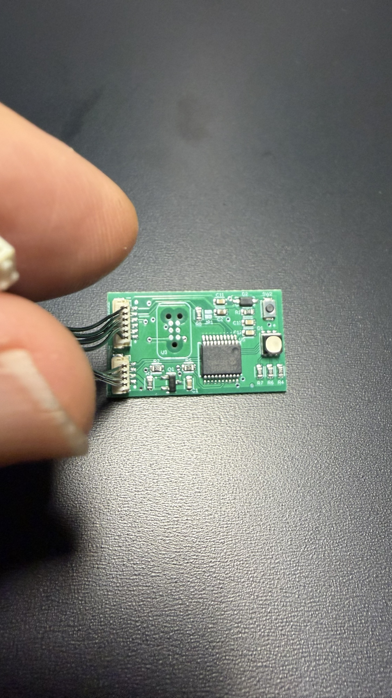
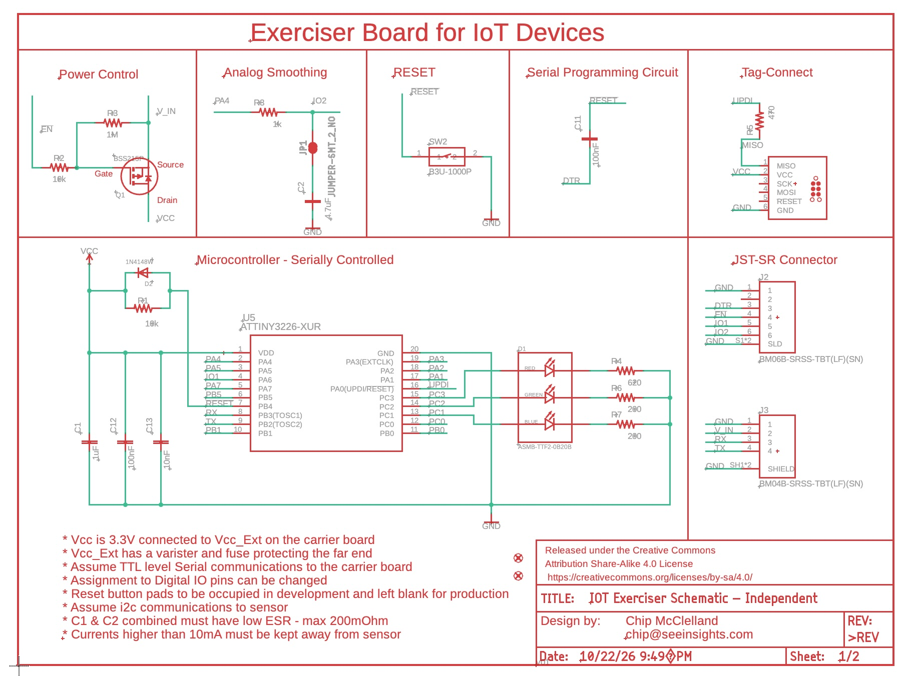

# Exerciser Board

A small, low-cost test device that plugs into the same JST-SR cable as the real IoT sensors and generates a known, repeatable pattern of interrupts. It lets us test the Generalized Core Counter's occupancy firmware without a person walking in front of a PIR: the counter reports occupied minutes, we know the right answer in advance, and any firmware change that shifts the number shows up as a difference.

Schematic (rev 1, 22 Oct 2026, CC BY-SA 4.0):

The board is an ATtiny3226 (SSOP-20, tinyAVR 2-series) with an RGB status LED, two 3.3 V I/O lines, an enable-controlled power switch, and a serial bootloader. This repository holds the PlatformIO project, the bring-up documentation and the work orders.

## Status (23 Oct 2026)

| Item | State |
| --- | --- |
| Boards 1, 2, 3 | Bootloader and fuses done and read back correctly (`00 00 01 FF FF FE 04 00 02`); V1 sketch uploads from PlatformIO and runs; LED sequence identical on all three. Board 3 is the test unit |
| Boards 4, 5 | In Raleigh, to be brought up with `docs/quickstart-boards-4-5.md` |
| V1 firmware | Frozen as V1.1 (tag `v1.1-frozen`, 23 Oct 2026, for the GCC v45/v46 baseline). It is the WO-006 build; WO-007 changed no code. Counter readings: 569 s (Dev-14) and 570 s (Dev-09) per session, essentially the 570 s design value; pulse spacing measured 29.97 s (about 0.1% off). Power-up scope check still to do |
| V2, V3 | Not started |

## How it works

The exerciser pretends to be a PIR sensor. The counter runs with `sensor.type = 1` (PIR), unchanged, and the exerciser is plugged into the PIR's place. That way the baseline measures the real PIR path in the counter: the interrupt, wake from sleep, debounce, session crediting and reporting.

- **IO1 (PA6, J2 pin 5)** is the PIR line: push-pull, idle LOW, 3.3 V HIGH. The counter detects the rising edge.
- **EN (J2 pin 4)** is the power enable, active low. The counter already drives its PIR enable line this way, so the counter turns the exerciser on and off with no extra firmware. A power-up always restarts the pattern.
- **IO2 (PA4, J2 pin 6)** is untouched in V1 (an input), until we confirm what it meets on the counter side of the cable.
- Serial (J3) is not used in V1.

### The V1 pattern

One 20-minute cycle, repeated until power is removed:

| Item | Value |
| --- | --- |
| Quiet time after power-up | 6 s, IO1 held LOW, with a 200 ms blue "armed" blink |
| Pulses per cycle | 10 |
| Pulse width | 2000 ms high (matches the real PIR's 2 s hold) |
| Pulse spacing | 30 s, rising edge to rising edge |
| Gap | no pulses from the last pulse until the next cycle starts at 20 min |

The schedule is computed from one start time, never from chained delays, so error does not accumulate beyond the oscillator.

### What the counter should report

A session runs from the first pulse until the last pulse plus the debounce (`sensor.setting1`).

| Debounce | Session | Per hour (3 sessions) | 16 h day |
| --- | --- | --- | --- |
| 300000 ms (production baseline) | 9.5 min | 28.5 min | 456 min |
| 60000 ms (quick bench checks only) | 5.5 min | 16.5 min | 264 min |

Tolerance is about ±1 s per session, because the counter credits whole seconds. Clean serial readings on the counter (23 Oct): 569 s (Dev-14) and 570 s (Dev-09). Two earlier sessions read 580 to 581 s while Dev-14 was on a laptop's USB; the cause is open and USB-host attachment is the lead. It is not the exerciser. The sketch's `DEBOUNCE_MS` must equal the counter's `sensor.setting1`; it is used only for the LED marker and the expected-value comment, and does not affect pulse timing.

For baseline runs, set the test Boron's `serialConnected` ledger setting off so it behaves like the field.

### LED

The colour shows where the counter should be in its session. Only the long, solid flashes are interrupts; the short flashes are status markers and never touch IO1.

| Colour | Meaning |
| --- | --- |
| Green, solid 2 s | First pulse: a new occupied session starts |
| Blue | The rest of the occupied period: pulses 2 to 10 solid for 2 s each, plus a 50 ms blink every 5 s between pulses and after the last one. The blue blinks stop at the session end, and the counter's own LED should go off within about 1 to 2 s |
| Red, 20 ms every 30 s | Between sessions: starts 30 s after the session ends |
| Blue, 200 ms at power-up | "Armed", during the 6 s quiet time |

With the baseline debounce the session ends 570 s after the first pulse and the red flashes run from 600 s to 1170 s. The LED load averages about 0.04 mA.

## Hardware summary

| Item | Detail |
| --- | --- |
| MCU | ATtiny3226, 16 MHz internal oscillator, brown-out detector disabled |
| Power | 3.3 V on J3 pin 2 (V_IN) through a high-side P-FET switch (Q1). EN floating = off; EN tied to GND = on. A dead-looking board is usually EN floating |
| Idle current | About 2 mA steady with the sketch running (meter reading); brief peaks to about 8 mA not yet explained |
| LED | Common-cathode RGB (D1): red PC3, green PC2, blue PC1, HIGH = on; each channel about 2 mA, so it is only ever on briefly |
| Reset | SW2 (manual) and DTR via C11 100 nF, both on PB4 (alternate reset pin); R1 10k with D2 (1N4148W) in parallel pulls reset up to VCC |
| Serial | J3 RX on PB3, TX on PB2 (TTL, 3.3 V) |
| Programming | UPDI on PA0 (Tag-Connect footprint U3) once for the bootloader and fuses; then serial through the Optiboot bootloader |
| Not populated this spin | ESD protection (left off on purpose) |

Connector pin maps:

| Pin | J2 (GPIO connector) | J3 (serial connector) |
| --- | --- | --- |
| 1 | GND | GND |
| 2 | not connected | V_IN |
| 3 | DTR | RX |
| 4 | EN | TX |
| 5 | IO1 (PA6) | |
| 6 | IO2 (PA4, through R8 1k; JP1 adds C2 4.7 uF for a PWM-as-analog filter) | |

J2 pin 6 is IO2, not ground. Use J2 pin 1 for ground.

## Getting started

### Bring up a new board

Follow `docs/quickstart-boards-4-5.md` (short) or `docs/bring-up-guide.md` (full detail and gotchas). In outline:

1. Inspect and check for shorts, then power through EN.
2. Ping the chip over UPDI (expect device ID `1E9527`) and read the fuses.
3. Burn the Optiboot bootloader from the Arduino IDE 1.8.13 with megaTinyCore 2.6.11. The burn writes the fuses; read them back and expect `00 00 01 FF FF FE 04 00 02`. Do not use megaTinyCore 2.6.8 or older.
4. Upload firmware over serial.

Never write `0x2` to the reset-pin setting (RSTPINCFG): it disables UPDI.

### Build and upload with PlatformIO

Open the folder in VS Code with the PlatformIO extension. Build with the PlatformIO build button; upload with the Serial Basic wired to J3 and DTR (J2 pin 3), EN tied low.

PlatformIO's defaults do not work for an Optiboot ATtiny3226. `platformio.ini` sets these, and the guide's Step 6 explains the symptom of each missing one:

- A newer toolchain package (`platformio/toolchain-atmelavr@~3.70300.0`).
- `-DCLOCK_SOURCE=0`.
- The program linked at `0x200`, just past the 512-byte bootloader (`-Wl,--section-start=.text=0x200`, with the builder's own `.text=0x0` removed in `build_unflags`).
- `-DUSING_OPTIBOOT`, so the program does not reset itself in a loop at start.

Upload uses the avrdude command the Arduino IDE runs, so the Arduino IDE's megaTinyCore 2.6.11 files must be installed. The upload port and the avrdude paths in `platformio.ini` are machine-specific; change them for your machine and keep that change out of git (see the Windows notes in the quickstart). The `-D` flag skips the chip erase so the bootloader survives. Do not upload over UPDI with an erase on a board that has the bootloader.

## Repository layout

| Path | Contents |
| --- | --- |
| `src/main.cpp` | The V1 sketch (the whole firmware) |
| `platformio.ini` | Build and upload configuration |
| `docs/bring-up-guide.md` | Full bring-up guide: procedures, pin maps, settings, gotchas, firmware plan |
| `docs/quickstart-boards-4-5.md` | Short bring-up instructions, with Windows notes |
| `docs/exerciser-handover-for-gcc.md` | The interface questions sent to the Generalized Core Counter side |
| `docs/work-orders/` | Work orders for the firmware and repo changes |

### Work orders

Work orders are written by the architect and executed by Claude Code, with a closing record in each; device operations (upload, scope, counter tests) are done by hand.

| WO | What it did |
| --- | --- |
| 001 | Created the git repo and first commit |
| 002 | V1 pulse pattern: look like a PIR to the counter |
| 003 | Pulse width 200 ms to 2000 ms, to match the real PIR |
| 004 | Named constants from the GCC spec, and the LED behavior |
| 005 | LED colours show the session state (green, blue, red) |
| 006 | Baseline debounce 300000 ms; LED timing derived from one constant |

## Open items

- Scope IO1 on board 3: 6 s quiet, 2.00 s highs, 30.0 s rise to rise, 10 pulses per cycle.
- Oscillator accuracy: done enough for V1. The counter measured 29.97 s pulse spacing, about 0.1% (about a minute over a 16 h day), inside the 0.5% bar.
- Power-up edge: an IO1 glitch at power-up is not suspected (the long sessions came from USB attachment). A scope check of IO1 at power-up is still worth doing once after 31 Oct, not urgent.
- Counter integration: confirm the carrier's sensor connector maps the PIR interrupt to IO1 and the enable to EN, and check what the carrier drives on the cable pins that reach J2 pin 3 (DTR, which resets the exerciser) and pin 6 (IO2).
- Double-wake check: with 2 s pulses, does a woken Boron wake a second time while the line is still high? Look for two `Wake: reason=PIR` log lines per pulse.
- Explain the brief 8 mA current peaks.
- Test the IO2 filter (JP1) with PWM.
- Power: the exerciser's own draw comes from the carrier's V_IN, so it adds to any power-budget measurement of the counter; a later work order can add sleep.

## Roadmap

- **V1 (this firmware):** fixed occupancy pattern, a regression baseline for occupied minutes by hour and by day.
- **V2:** a general sketch the Boron reconfigures over serial, for example target occupancy and visitation counts.
- **V3:** analog outputs, for example simulated soil moisture, using PWM through the JP1 filter on IO2.

Not in V1: serial, configuration from the Boron, hourly alignment, analog outputs, COUNTING patterns.
